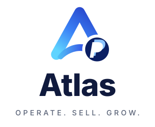
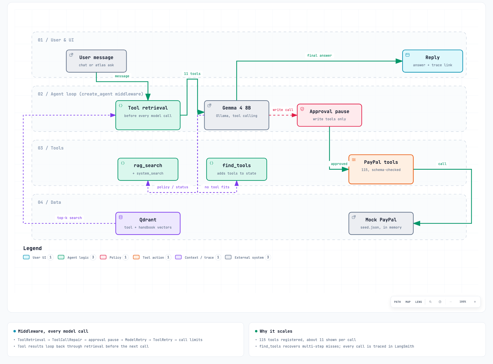
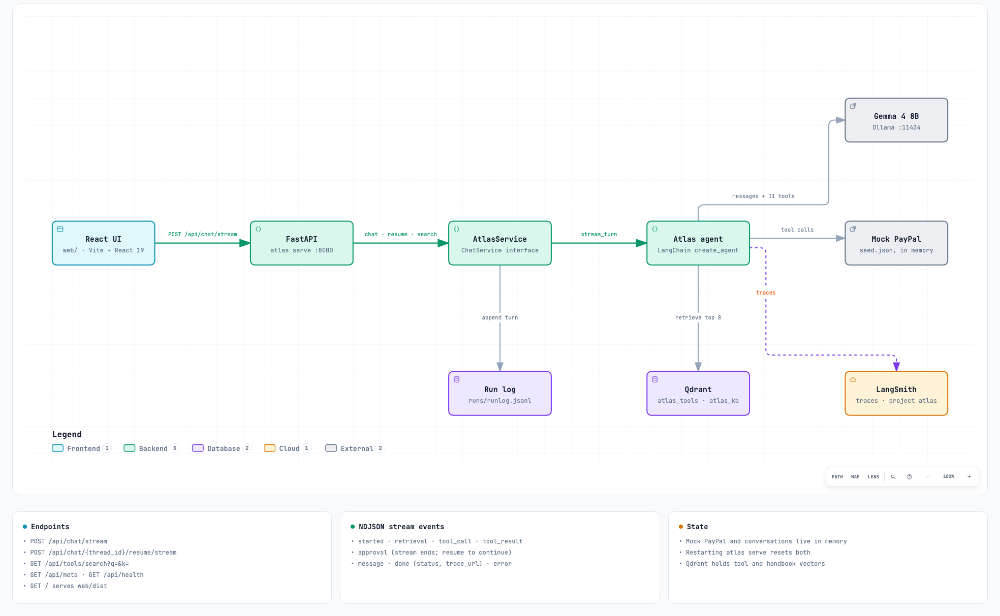

<p align="center">
  
</p>

A chat agent that stays accurate with 100+ API tools. Atlas registers all 115 PayPal REST operations but shows the model only the ~11 tools that match each request, found by vector search.

Built with LangChain `create_agent`, Qdrant, local bge-small embeddings and LangSmith tracing. By default it runs Gemma 4 8B locally through Ollama: free, with no rate limits.

## Why

Sending every tool with every request doesn't scale. PayPal's 115 operations are about **369k tokens** of raw schema (about 51k trimmed), and near-identical tools (`invoices_list`, `invoices_search-invoices`, `invoices_get`) confuse the model. Retrieval keeps each request small, however many tools exist.

## How it works



1. **Ingest:** each OpenAPI operation becomes a tool. Schemas are trimmed (headers, read-only fields and examples dropped), and required fields are always kept, which a test proves.
2. **Enrich and index:** each tool gets a one-line purpose, 5 example requests and optional curated keywords, stored as several vectors in Qdrant.
3. **Retrieve before every model call:** middleware swaps the tool list for the top 8 matches plus 3 always-on tools (`find_tools`, `rag_search`, `system_search`), within a request token budget.
4. **Recover:** if the next step needs a tool that wasn't retrieved, the model calls `find_tools`, and the matches become callable on its next call.
5. **Stay safe:** tool inputs are schema-checked, and write tools pause for your approval.

PayPal is a **mock**: an in-memory fake seeded from [`seed.json`](src/atlas/backend/seed.json), so nothing touches a real account. Swapping in real PayPal means writing a second implementation of the same `Backend` interface.

## Quickstart

Needs Python 3.12 with [uv](https://docs.astral.sh/uv/), Docker, Node 20+ and [Ollama](https://ollama.com).

```bash
uv sync
docker compose up -d                              # Qdrant on :6333
ollama pull gemma4
ollama create atlas-gemma4 -f ollama/Modelfile    # 16k context window
cp .env.example .env                              # then set the values below
uv run atlas ingest && uv run atlas index && uv run atlas kb
```

```bash
ATLAS_LLM_PROVIDER=openai
LLM_BASE_URL=http://localhost:11434/v1
LLM_API_KEY=ollama
ATLAS_MODEL=atlas-gemma4
ATLAS_MAX_REQUEST_TOKENS=12000
ATLAS_MAX_OUTPUT_TOKENS=4096
LANGSMITH_API_KEY=                                # optional, for traces
```

Run it:

```bash
uv run atlas ask "What was my total sales volume last month?"
uv run atlas chat                                 # interactive, asks before changes

cd web && npm install && npm run build && cd ..
uv run atlas serve                                # web UI at http://127.0.0.1:8000
```

The web UI streams each turn live: which tools retrieval picked (with scores), each tool call and result, Approve/Reject for changes, and LangSmith links. Each chat has its own URL, `/c/<thread-id>`, and the same ID groups its turns into one LangSmith thread.

## HTTP API



| Method | Path | Does |
|---|---|---|
| POST | `/api/chat/stream` | Run a message; streams NDJSON events |
| POST | `/api/chat/{thread_id}/resume/stream` | Approve or reject a paused change |
| GET | `/api/chat/{thread_id}` | A thread's transcript (backs `/c/<thread-id>` URLs) |
| GET | `/api/tools/search?q=&k=` | Search the tool catalog |
| GET | `/api/meta`, `/api/health` | Model info, liveness |

Stream events: `started`, `retrieval`, `tool_call`, `tool_result`, `approval`, `message`, `done`, `error`.

Interactive diagrams: [`agent.html`](docs/diagrams/agent.html) and [`api.html`](docs/diagrams/api.html), made with Archify.

## Results

**Retrieval only** (no LLM; held-out test split, 63 cases):

| Recall@3 | Recall@5 | Recall@8 | Precision@5 | MRR | nDCG@5 |
|---:|---:|---:|---:|---:|---:|
| 0.770 | 0.857 | 0.936 | 0.213 | 0.748 | 0.747 |

**Full agent** (Groq `gpt-oss-120b`, 10 cases):

| Task completion | Tool execution success | p95 latency | Cost |
|---:|---:|---:|---:|
| 6 of 9 | 100% | 114 s* | $0 |

\* Mostly waiting out Groq's free-tier rate limit.

- **Cases:** 151 hand-written, split 60 dev (used for tuning) and 91 test (held out).
- **Caveat:** the curated keywords lifted test Recall@8 from 0.921 to 0.936, but they were written knowing some test misses, so that gain isn't a clean held-out number.
- **Commands:** `uv run atlas eval retrieval` (R0, about 10 s) and `uv run atlas eval agent`.

## Design choices

- **Single agent with retrieval, not multi-agent:** no extra routing hop, and a missed tool is recoverable in the same run.
- **LangChain middleware:** one hook swaps the tool list per model call; approval pauses, retries and limits come built in.
- **Dense search only:** hybrid BM25 lowered Recall@8 by 0.05–0.11 on the dev split ([tuning notes](reports/r0_tuning.md)).
- **Provider-agnostic:** Gemini, Groq, OpenRouter or Ollama is a `.env` change ([setups](architecture.md#config-configpy-pydantic-settings)).

## Repo

```
src/atlas/   tools/ retrieval/ agent/ api/ backend/ evals/
specs/       PayPal OpenAPI specs (Apache-2.0) + overrides (read-only list, keywords)
evals/       151 cases, baselines, results
web/         React UI          kb/  handbook for rag_search
docs/        decisions log, diagrams
```

More detail: [plan.md](plan.md) · [architecture.md](architecture.md) · [docs/decisions.md](docs/decisions.md) (every decision and every problem hit, with its fix).

## License

MIT. The PayPal specs in `specs/paypal/` keep their Apache-2.0 license.
