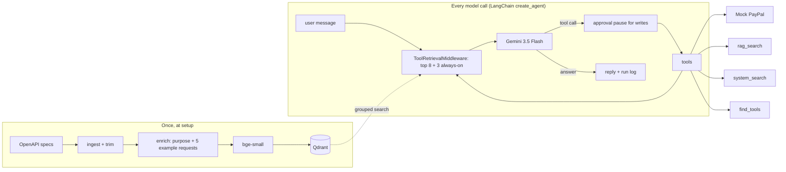

# Atlas

A chat agent that stays accurate with 100+ API tools. On every model call, Atlas searches its tool catalog and gives the model only the tools that match the request, instead of all of them. Phase 1 uses PayPal's 115 REST operations plus two extra tools (knowledge-base search and system search), and an eval harness measures how well it picks tools and fills in their inputs.

Built on LangChain `create_agent`, Gemini 3.5 Flash (free tier, through its OpenAI-compatible endpoint), local bge-small embeddings and Qdrant, with LangSmith for tracing and evals.

## The problem

Sending every tool definition with every request doesn't scale. PayPal's 115 operations come to about **369k tokens** as raw OpenAPI schemas, and about 57k even after trimming. Accuracy also drops as near-identical tools (`invoices_list`, `invoices_search-invoices`, `invoices_get`) compete for the model's attention. At 500 or 2,000 tools, sending everything stops being possible at all.

## How Atlas works



1. **Ingest** turns each OpenAPI operation into a tool. It resolves `$ref`s to depth 3, drops headers, read-only fields and examples, and trims harder (down to a depth-2 floor) when a tool is over 1,500 tokens. Required fields are never dropped, and a test proves it.
2. **Enrich** has DeepSeek write a one-line purpose and 5 example requests per tool: 3 direct requests and 2 questions that need the tool's data. This closes the gap between how people talk ("what did I sell last month?") and how APIs are named (`search_get`).
3. **Index**: each tool is stored as about 6 vectors in Qdrant (its description plus each example). Grouped search returns ranked *tools*, each scored by its best-matching vector.
4. **Retrieve per model call**: `ToolRetrievalMiddleware` searches with the last two user messages and swaps the request's tool list for the top 8 plus 3 always-on tools: `rag_search`, `system_search` and `find_tools`.
5. **`find_tools`** covers multi-step requests. When the next step needs a tool that wasn't retrieved (create, then *send*), the model searches the catalog itself, and the matches become callable on its next call.
6. **Safety**: write tools pause for approval in chat. Inputs are checked against the tool's schema before anything runs, and errors go back to the model once so it can correct itself.

## Design choices and trade-offs

- **Single agent with retrieval, not multi-agent.** A supervisor routing to domain sub-agents adds a model hop to every request. A wrong handoff can't be recovered, and someone has to draw the domain lines by hand. Retrieval scales by adding vectors, and `find_tools` recovers from a miss inside the same run. Multi-agent is a phase-2 comparison.
- **LangChain `create_agent` middleware.** The `wrap_model_call` hook can swap the tool list on every model call, which is exactly what retrieval needs. The approval pause, retries and call limits come built in. LangChain also ships an LLM-based tool picker (`LLMToolSelectorMiddleware`), which the evals compare against.
- **Qdrant with grouped search.** One result per tool, from several vectors per tool, with no post-processing. Filters (service, description-only) are payload filters.
- **bge-small, dense only.** On the dev split, bge-base and 10 examples per tool moved results by about one case (noise). Hybrid dense + BM25 was worse on every setup tried, losing 0.05–0.11 Recall@8. See [reports/r0_tuning.md](reports/r0_tuning.md).
- **Mock PayPal.** Generic REST routing with PayPal behaviour as data (`seed.json`), so evals are repeatable and need no sandbox account. Every one of the 115 tools passes a minimal valid call in the tests.

## Quickstart

```bash
uv sync
docker compose up -d          # Qdrant on :6333
cp .env.example .env          # add LLM_API_KEY (a Gemini API key) and, optionally, LANGSMITH_API_KEY
uv run atlas ingest           # specs → data/tools.json
uv run atlas enrich           # purposes + example requests (cached in data/enrichment.json)
uv run atlas index            # tool vectors → Qdrant
uv run atlas kb               # handbook → Qdrant
uv run atlas chat             # or: uv run atlas ask "Is there a dispute open from user_123?"
```

### Web UI

```bash
cd web && npm install && npm run build && cd ..
uv run atlas serve            # http://127.0.0.1:8000
```

The UI takes Penny's look (from the procurement agent) into React:
- **Chat with a live timeline:** each turn streams its retrieval step, tool calls with their inputs and results, then the answer and its LangSmith trace link.
- **Approvals:** changes wait for Approve or Reject.
- **Retrieval panel:** which tools out of 115 the model saw on each call, with their scores, which ones the token budget dropped, and a search box to try any request against the catalog.

For UI development, run `npm run dev` in `web/` (Vite on :5173, proxying `/api` to :8000).

### Providers

`ATLAS_LLM_PROVIDER=gemini` uses the native Gemini client. `openai` uses any OpenAI-compatible endpoint, such as a local Ollama, Groq or OpenRouter.

**Local and free (default for development):** Gemma 4 8B through Ollama, with a 16k context window. Ollama's default window is small and silently cuts longer prompts.

```bash
ollama pull gemma4
ollama create atlas-gemma4 -f ollama/Modelfile
```

```bash
ATLAS_LLM_PROVIDER=openai
LLM_BASE_URL=http://localhost:11434/v1
LLM_API_KEY=ollama                # any non-empty value; Ollama ignores it
ATLAS_MODEL=atlas-gemma4
ATLAS_MAX_REQUEST_TOKENS=12000    # stay inside the 16k window
ATLAS_MAX_OUTPUT_TOKENS=4096      # leaves room for thinking before the answer
```

**Groq free tier** (used for the agent-run results below):

```bash
ATLAS_LLM_PROVIDER=openai
LLM_BASE_URL=https://api.groq.com/openai/v1
ATLAS_MODEL=openai/gpt-oss-120b
ATLAS_REASONING_EFFORT=low
ATLAS_MAX_REQUEST_TOKENS=7000     # Groq's free tier caps each request at 8,000 tokens
ATLAS_MAX_OUTPUT_TOKENS=1024
```

`data/enrichment.json` is committed, so `atlas enrich` is a no-op unless the specs change.

## Evals

```bash
uv run atlas eval retrieval            # Recall@k, Precision@k, MRR, nDCG@k; no LLM, about 10 s
uv run atlas eval leakage              # cases too close to stored example requests
uv run atlas eval agent                # one Atlas run per test case: tool execution success, task completion, p95 latency, cost
```

- **151 hand-written cases:** 81 single-tool, 30 multi-step, 15 knowledge-base, 10 system and 15 that should get a question back. They are split 60 **dev** (the only cases used for tuning) and 91 **test** (held out, reported below).
- **Retrieval (no LLM):** Recall@k, Precision@k, MRR and nDCG@k at k = 3, 5, 8, 10. `atlas eval retrieval --check-baseline` fails if test Recall@8 drops below the committed baseline.
- **Agent run:** tool execution success, task completion, p95 latency and cost per task. Each case runs against a fresh mock, and its LangSmith trace link is saved with the results. Runs that hit an API error are left out of the scores and flagged.

## Results

**Retrieval only (held-out test split, 63 cases that need an indexed tool)**

| Recall@3 | Recall@5 | Recall@8 | Precision@5 | MRR | nDCG@5 |
|---:|---:|---:|---:|---:|---:|
| 0.778 | 0.857 | 0.921 | 0.213 | 0.743 | 0.745 |

Precision@5 is capped at 0.2 on single-tool cases (one right answer in five slots), so it compares setups rather than meeting a target. Most Recall@8 misses are multi-step requests, where one query has to surface two tools; inside the agent `find_tools` picks up the second one.

**Agent run** (Groq `openai/gpt-oss-120b`, free tier, 10 cases across every category including the brief's three requests)

| Cases scored | Task completion | Tool execution success | p95 latency | Cost per task |
|---:|---:|---:|---:|---:|
| 9 of 10 | 66.7% (6/9) | 100% | 114 s | $0 (free tier) |

- **p95 latency is mostly waiting:** Groq's free tier allows 8,000 tokens a minute, so the retry middleware waits out each limit.
- **Excluded:** one case hit a Groq-side schema rejection before Atlas saw the tool call, so it's left out as a harness error (problem 32).
- **Misses:**
  - Last month's sales were answered from invoices instead of transactions.
  - The $50 invoice was created but never sent.
  - Pausing a subscription asked for the reason the API requires.

## Layout

```
specs/paypal/        PayPal OpenAPI specs (Apache-2.0, commit 90e8041) + read-only overrides
kb/                  handbook for rag_search (fictional merchant)
src/atlas/
  tools/             ingest, trimming, enrichment, registry, rag, system, find_tools
  retrieval/         embedders, Qdrant tool index
  agent/             middleware, builder, turn runner, event stream, run log, prompt
  api/               FastAPI app and chat service
  backend/           Backend interface, mock PayPal, seed data
  evals/             cases, scorers, R0 runner, agent runner, report
evals/               cases.jsonl, baselines, fixtures, results
web/                 React UI (Vite, TypeScript)
reports/             ingest sizes, R0 tuning notes
```

See [plan.md](plan.md) and [architecture.md](architecture.md) for the full plan and design contracts, and [docs/decisions.md](docs/decisions.md) for every decision made along the way and every problem hit, with its cause, fix and check.

## License

MIT. PayPal's OpenAPI specs under `specs/paypal/` keep their own Apache-2.0 license.
