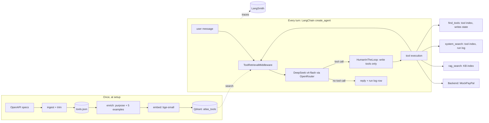

# Atlas architecture

How Atlas is put together, and the contracts its code must keep. When code and this file disagree, either the code is wrong or this file is updated first, in its own edit.

## Overview



All 118 tools are registered with `create_agent` once. Before every model call, the middleware cuts that list down to the tools that match the request. Tool results go back through the middleware, so each step of the loop gets its own search.

## Components

### ToolSpec (`tools/spec.py`)

One record per API operation. Everything after ingest reads this record, never the raw spec.

| Field | Type | Meaning |
|---|---|---|
| `name` | str | A name the model API accepts (`^[a-zA-Z0-9_-]{1,64}$`), e.g. `invoices_create` |
| `original_id` | str | The `operationId` from the spec, e.g. `invoices.create` |
| `service` | str | e.g. `paypal` (`stripe` in phase 2) |
| `group` | str | The spec file the operation came from, e.g. `invoicing_v2` |
| `method`, `path` | str | HTTP method and path template |
| `summary`, `description` | str | From the spec, description cut to 300 characters |
| `access` | `read` \| `write` | `GET` means read, as do operations listed under `read_only` in `specs/<service>/overrides.json` (POSTs that only search or compute, such as invoice search or the next invoice number). Anything else is write. |
| `params_schema` | dict | Trimmed JSON Schema with properties `path`, `query` and `body` |
| `full_schema_ref` | str | Where to find the untrimmed schema, used by the mock to check inputs |
| `purpose`, `examples` | str, list[str] | Added by the enrich step |
| `keywords` | str | Curated business terms from `specs/<service>/overrides.json` (`keywords`), for operations whose API name hides what they're for (`search_get` lists transactions, which is where sales and revenue live) |
| `raw_tokens`, `trimmed_tokens` | int | Size before and after trimming |

In phase 2, names get a service prefix (`stripe__invoices_create`). The ingest step guarantees every name is unique.

### Ingest (`tools/ingest.py`)

Spec files → `list[ToolSpec]` → `data/tools.json`. Trimming rules, applied in this order:

1. Resolve internal `$ref`s to depth 3. Anything deeper becomes `{"type": "object"}` with its description kept.
2. Drop `readOnly` properties, `example`/`examples` and `x-*` keys.
3. Drop every header parameter. In the PayPal specs all 7 are auth or transport (`Authorization`, `PayPal-Request-Id`, `PayPal-Auth-Assertion`, `Prefer`, `PayPal-Client-Metadata-Id`, `User-Agent`, `PayPal-Partner-Attribution-Id`), so the harness owns them and the model never sees them.
7. Request body: use the `application/json` schema when there is one, otherwise the first content type's schema.
10. `allOf` branches are merged into one object, and `required` only lists properties defined at the same level. Gemini rejects a schema whose `required` names a property defined only inside an `allOf` branch, and a flat object is easier for any model to fill in.
9. Token budget (`ATLAS_MAX_TOOL_TOKENS`, 1,500). A tool over budget is trimmed again at depth 2 with 120-character descriptions, then depth 2 with 60. Depth 2 is the floor: depth 1 strips fields like `items` and `primary_recipients` from `invoices_create`, which the call needs. Tools still over budget are listed in `reports/ingest_sizes.md`.
8. The full schema (for the mock's input checks) is resolved to depth 8 with only examples and `x-*` keys removed.
4. Cut property descriptions to 120 characters.
5. Keep at most 20 enum values. If there are more, add a note listing how many were dropped.
6. **Never drop a property that is in `required`**, at any depth.

A new service is a new folder under `specs/` plus an entry in `SERVICES` in `config.py`. No code changes.

### Enrich (`tools/enrich.py`)

One model call per tool returns `{purpose, examples[5]}` as checked JSON. The result is cached in `data/enrichment.json`, keyed by a hash of the prompt and the operation's name, summary and description (not its schema), so trimming changes don't regenerate the examples behind the retrieval baseline.

### Retrieval (`retrieval/`)

```python
class Embedder(Protocol):
    def embed_docs(self, texts: list[str]) -> np.ndarray: ...
    def embed_query(self, text: str) -> np.ndarray: ...

class ToolIndex(Protocol):
    async def search(
        self, query: str, k: int, service: str | None = None, heads_only: bool = False
    ) -> list[Hit]: ...

@dataclass(frozen=True)
class Hit:
    name: str
    score: float
    rank: int
```

- `BgeEmbedder` normalises its vectors and adds bge's search prefix to queries.
- Tools with curated `keywords` get one more point (`kind=keywords`) holding those terms, and the model-facing tool description adds "Use for: …". A tool's score is still its best point.
- `QdrantToolIndex` uses a Qdrant server (Docker, `qdrant/qdrant:v1.19.2`) through `AsyncQdrantClient`. Collection `atlas_tools` stores 384-dimension cosine vectors: one point for `name + purpose + description` (`kind=head`) and one per example request (`kind=example`), about 6 per tool. The payload is `{tool, service, kind}`.
- Search uses `query_points_groups` with `group_by="tool"` and `group_size=1`, so Qdrant returns ranked tools, not vectors. A tool's score is its best vector, and each tool appears once. `service` and `heads_only` become payload filters, so a description-only search needs no second index.
- Point IDs are `uuid5(tool + text)`. `atlas index` recreates the collection, so a rebuild is clean and repeatable.
- Always-on tools are **not** in the index.

### Agent (`agent/`)

**`ToolRetrievalMiddleware`** (`before_model` + `wrap_model_call`):

```
query   = the last 2 user messages, joined
hits    = index.search(query, k=config.k)
candidates = state.found_tools (newest first), then hits by rank
if max_request_tokens: keep candidates in that order while
    prompt + always-on tools + messages + output reserve + chosen tools ≤ max_request_tokens
allowed = chosen ∪ ALWAYS_ON
request = request.override(tools=[t for t in request.tools if t.name in allowed])
return handler(request)
```

- `ALWAYS_ON = {rag_search, system_search, find_tools}`
- Tool sizes are measured once from each tool's real OpenAI-format definition. Message sizes are estimated as characters / 4. The budget exists for providers that cap request size (Groq's free tier: 8,000 tokens per request and per minute).
- The middleware's state adds `found_tools: list[str]`, which only `find_tools` writes to (through `Command(update=…)`).

**`build_atlas(config) -> agent`** calls `create_agent` with:
- `model`: built by `atlas.llm.build_chat_model` from the `PROVIDERS` registry, picked by `ATLAS_LLM_PROVIDER`. `gemini` (the default) is the native `ChatGoogleGenerativeAI`, which carries Gemini 3's thought signatures between tool calls; the OpenAI-compatible endpoint drops them, and the second call then fails with 400. `openai` is `ChatOpenAI` against any OpenAI-compatible `LLM_BASE_URL` (OpenRouter, Groq, Mistral, a local Ollama at `http://localhost:11434/v1`). For Ollama, `ollama/Modelfile` builds a 16k-context variant of Gemma 4 8B (`ollama create atlas-gemma4 -f ollama/Modelfile`), because Ollama's default window is small and it silently drops whatever overflows. Temperature 0, 4,096 output tokens, no client-side retries. Adding a provider means adding a registry entry.
- `tools`: every tool in the registry plus the 3 always-on tools
- `middleware`, in this order:
  1. `ToolRetrievalMiddleware`
  2. `HumanInTheLoopMiddleware` on `access == write` tools (only when `config.approve_writes`)
  3. `ToolCallRepairMiddleware`: when the provider itself rejects the model's tool call (Groq validates arguments server-side and returns `tool_use_failed`), the rejection reason goes back to the model as a note, and the call is retried up to twice. That matches how Atlas's own schema-check errors go back to the model.
  4. `ModelRetryMiddleware` (per-minute 429s and server errors: 5 retries, 15 s initial delay, doubling up to 60 s, then raise). A daily-quota 429 is never retried (`is_retryable_model_error`), because waiting a minute can't clear it.
  5. `ToolRetryMiddleware` (backend 429 and 5xx only)
  6. `ModelCallLimitMiddleware` (8)
  7. `ToolCallLimitMiddleware`
- `checkpointer`: `InMemorySaver`
- `system_prompt`: from `agent/prompt.md`. It sets Atlas's persona (dry wit: facts first, at most one understated line, never joking about errors, disputes or money that went wrong) and the working rules: look things up rather than guess, search the catalog again before saying no, ask one question when something required is missing, the data rules (sales and revenue come from transactions, not invoices; amounts as two-decimal strings; UTC ISO dates), and the answer format (the answer first, then the IDs touched).

**`run_turn` (`agent/turn.py`)** runs one user message, resumes approval pauses through an approver callback (the CLI asks, evals approve everything), and returns the answer, tool calls with their HTTP status, tokens, latency, status and the LangSmith trace URL. Status is `error` (an exception such as an API or network failure), `limit_hit`, `asked_user` (the answer contains a question and no change was made) or `completed`. Evals leave `error` cases out of every metric and report them separately, so an outage can't look like a weak agent.

**Run log (`agent/runlog.py`):** one JSON line per finished turn in `runs/runlog.jsonl`:
`{run_id, thread_id, ts, user_message, tools_exposed, tool_calls:[{name, args, ok, error}], status, latency_ms, tokens_in, tokens_out, langsmith_url}`.
`status` is one of `completed`, `asked_user`, `failed` or `limit_hit`.

### Backend (`backend/`)

```python
class Backend(Protocol):
    async def call(self, spec: ToolSpec, args: dict) -> BackendResult: ...
    def reset(self) -> None: ...

@dataclass
class BackendResult:
    status: int
    body: dict
```

`MockPayPal`:
- Checks `args` against the **full** schema and returns a 422 with the failing paths if they don't match.
- Routes each call generically from its path template: the part before the first `{param}` is the collection, the param is the item ID, and the next segment is the action (`/v2/invoicing/invoices/{invoice_id}/send` → collection `/v2/invoicing/invoices`, action `send`). Collection GET lists, POST creates, item GET/PUT/PATCH/DELETE read, update or remove, and an action applies its effect.
- Everything PayPal-specific is data in `backend/seed.json`. That covers the seeded collections (invoices, templates, disputes, captures, authorizations, refunds, orders, plans, subscriptions, products, webhooks, payouts, trackers, payment tokens, web profiles, transactions, balances) and each collection's ID prefix, list key and status on create. It also covers what each action does (`send` sets SENT; `refund` sets REFUNDED and creates a refund in `/v2/payments/refunds`), search aliases (`search-invoices` searches invoices), and the date field the transaction list filters on. Seeded IDs follow the specs' patterns (order IDs are `^[A-Z0-9]+$`).
- Operations on collections that aren't seeded return a minimal success placeholder (`{id, status: "OK"}`, or an empty list for GET).
- A test calls all 115 tools with a minimal valid input generated from each schema (`tools/sample.py`) and requires a 2xx from every one.
- Fake errors (429, 500) can be switched on through settings, so the error handling gets tested.

The registry builds an async `StructuredTool` per spec that calls `backend.call`. A real sandbox backend in phase 2 would be another `Backend` implementation, with no changes to the agent.

### Extra tools (`tools/`)

| Tool | Inputs | Returns |
|---|---|---|
| `rag_search` | `question: str, k: int = 4` | `[{text, source, score}]` from the Qdrant collection `atlas_kb`, built from `kb/*.md` in chunks of about 500 tokens |
| `system_search` | `query: str, scope: "tools" \| "runs"` | `tools`: `[{name, purpose, access}]` from the tool index. `runs`: the latest matching rows from the run log. |
| `find_tools` | `query: str, k: int = 5` | `[{name, purpose}]`, and adds those names to `state.found_tools` |

## HTTP API and web UI

`atlas serve` starts a FastAPI app (`api/app.py`). It builds one Atlas agent (approval pauses on) with one mock backend and one checkpointer; each conversation is a `thread_id`.

| Method | Path | Purpose |
|---|---|---|
| POST | `/api/chat/stream` | Run one user message. Body `{message, thread_id?}`. Streams NDJSON events. |
| POST | `/api/chat/{thread_id}/resume/stream` | Answer an approval pause. Body `{decisions: [{type: "approve" \| "reject", message?}]}`. Streams NDJSON. |
| GET | `/api/chat/{thread_id}` | The thread's transcript: each turn's user message and the events it streamed, so a reloaded `/c/<thread-id>` page replays it. 404 when unknown (threads live in memory). |
| GET | `/api/tools/search?q=&k=` | Retrieval inspector: ranked tools with score, purpose, access and group |
| GET | `/api/meta` | Model, tool count and request budget, for the header |
| GET | `/api/health` | Liveness |
| GET | `/`, `/c/{thread_id}` | The built React app (`web/dist`); `/c/…` serves the same page, which loads that thread |

**Stream events** (`agent/stream.py`, one JSON object per line):

| `type` | Fields | When |
|---|---|---|
| `started` | `thread_id` | First line |
| `retrieval` | `step`, `query`, `hits [{name, score}]`, `shown [names]`, `dropped [names]` | Before each model call |
| `tool_call` | `id`, `name`, `args`, `access` | The model asked for a tool |
| `tool_result` | `id`, `name`, `status`, `body` | The tool returned |
| `approval` | `requests [{name, args, description}]` | A write tool is paused for approval; the stream ends here |
| `message` | `text` | The model's reply |
| `done` | `status`, `trace_url` | Turn finished |
| `error` | `detail` | Turn failed |

`ToolRetrievalMiddleware` writes `last_retrieval` (query, scored hits, shown, dropped by the budget) to state in `before_model`; `stream_turn` turns that state update into the `retrieval` event.

**Web app (`web/`):** Vite + React 19 + TypeScript, Penny's CSS tokens and components ported as plain CSS, `react-markdown` for answers. The chat thread shows each turn as a timeline (retrieval step → tool calls with results → approval panel → answer with its LangSmith trace link). The side panel is the retrieval inspector: the latest retrieval's ranked hits (shown vs. dropped by the budget) and a search box over the catalog. Each conversation has its own URL, `/c/<thread-id>`. The UI moves there when the stream's `started` event arrives, and on load or back/forward it fetches `/api/chat/{thread_id}` and replays the stored events through the same reducer as live streaming. `npm run dev` proxies `/api` to `localhost:8000`; `npm run build` writes `web/dist`, which FastAPI serves.

## Errors

| Error | Where it's handled | What happens |
|---|---|---|
| Input fails the schema check | Tool wrapper | The error goes back to the model as the tool result. The model may retry once. |
| 4xx from the backend | Tool wrapper | Goes back to the model so it can explain to the user or correct itself |
| 429 / 5xx | `ToolRetryMiddleware` | Up to 3 retries with a growing wait, without calling the model |
| A tool name that doesn't exist | Tool execution | An error naming `find_tools` as the fix |
| Step limit reached | Limit middleware | The run ends with `status=limit_hit` and a message to the user |
| Model API error (429 quota, 5xx) | `ModelRetryMiddleware` | Retried with backoff, then the turn is `error` and left out of eval scores |
| Write tool without approval | `HumanInTheLoopMiddleware` | Pauses the run; continues on yes, gives up on no |

## Config (`config.py`, pydantic-settings)

| Env var | Default |
|---|---|
| `ATLAS_LLM_PROVIDER` | `gemini` (native client) or `openai` (any OpenAI-compatible endpoint; used for Groq) |
| `ATLAS_MAX_REQUEST_TOKENS` | unset (no limit); `7000` for Groq's free tier; `12000` for local Ollama with a 16k window |
| `ATLAS_REASONING_EFFORT` | unset; `low` for gpt-oss on Groq (reasoning tokens count toward the per-minute cap) |
| `LLM_API_KEY` | required for the agent, enrichment and the agent eval |
| `LLM_BASE_URL` | `https://generativelanguage.googleapis.com/v1beta/openai/` (Gemini) |
| `ATLAS_MODEL` | `gemini-3.5-flash` |
| `ATLAS_K` | `8` |
| `ATLAS_EMBED_MODEL` | `BAAI/bge-small-en-v1.5` |
| `ATLAS_APPROVE_WRITES` | `true` (evals set it to `false`) |
| `ATLAS_PRICE_IN_PER_M`, `ATLAS_PRICE_OUT_PER_M` | `0`, `0` (Gemini free tier). Set them to a paid price to get cost per task in dollars; input tokens per task are always reported. |
| `QDRANT_URL`, `QDRANT_API_KEY` | `http://localhost:6333`, unset |
| `ATLAS_TOOLS_COLLECTION`, `ATLAS_KB_COLLECTION` | `atlas_tools`, `atlas_kb` |
| `LANGSMITH_TRACING`, `LANGSMITH_API_KEY`, `LANGSMITH_PROJECT` | `true`, required for traces, `atlas` |

## Evals

### Case format (`evals/cases.jsonl`)

```json
{"id": "inv-001",
 "query": "Send an invoice for $50 to jane@example.com for logo design",
 "history": [],
 "category": "single",
 "expected_tools": ["invoices_create", "invoices_send"],
 "ordered": true,
 "arg_checks": {"invoices_create": {"detail.currency_code": "USD", "items[0].unit_amount.value": "50.00"}},
 "expect_question": false,
 "split": "dev"}
```

- `category` is one of `single`, `multi`, `rag`, `system` or `clarify`.
- `split` is `dev` (60 cases, the only ones used for tuning) or `test` (90 held-out cases, reported as the result). Tuning on the reported cases would inflate the scores.
- `alternatives` (optional) maps an expected tool to equivalents that also count, e.g. `{"invoices_search-invoices": ["invoices_list"]}`.
- `arg_checks` use dotted paths into the call's arguments (`body.items[0].unit_amount.value`). A plain value must match; numbers compare as numbers (`"50"` = `"50.00"`). `{"prefix": "2026-09-01"}` and `{"contains": "jane@"}` are also allowed.
- `answer_contains` (optional, RAG cases): case-insensitive strings that must all appear in the final answer.
- Evals run with `ATLAS_TODAY=2026-10-24`, so "last month" always means September 2026.

### Metrics

`E` is the set of expected tools in the index for a case, and `R_k` is the top-k results. Cases where `E` is empty (always-on tools only, or clarify cases) are left out of the retrieval metrics.

| Metric | Formula |
|---|---|
| Recall@k | `|E ∩ R_k| / |E|` |
| Precision@k | `|E ∩ R_k| / k` |
| MRR | `1 / rank of the first tool in E`, or 0 if none is in the top 10 |
| nDCG@k | Relevance is 1 for tools in `E`, 0 otherwise. `DCG = Σ rel_i / log2(i+1)` divided by the best possible DCG. |
| Tool execution success | Tool calls that pass the schema check and return 2xx, divided by all tool calls |
| Task completion | Every tool in `expected_tools` called (in order if `ordered`), every `arg_check` passes, no writes outside `expected_tools`, and status `completed`. For `clarify` cases: no write calls and status `asked_user`. |
| p95 latency | The 95th percentile of `latency_ms` across cases |
| Cost per task | `(tokens_in × price_in + tokens_out × price_out) / 1e6`, averaged |

Retrieval metrics are reported at k = 3, 5, 8 and 10, overall, per split and per `group`. Agent metrics are reported overall, per split and per category.

### Runs

| Command | What runs | Needs a model key |
|---|---|---|
| `atlas eval retrieval` (R0) | `ToolIndex.search` per case; retrieval metrics only | No |
| `atlas eval agent` | Atlas (k = 8, approval off) once per case, against a fresh mock and run log; agent metrics | Yes |

The agent run takes `--split` and `--limit`, runs a few cases at a time, and writes `evals/results/<timestamp>-agent.json` with the metrics and each case's tool calls, status and LangSmith trace link. A turn that raised an exception is status `error`: it's left out of the metrics, listed separately, and makes the command exit non-zero.

### Rules for the eval data
- Test requests are written by hand, never copied from the stored example requests.
- The leakage check fails any case with cosine similarity > 0.9 to a stored example request.
- A change that lowers R0 Recall@8 below the last committed result fails CI.

## Invariants

1. The model never sees more than `k + 3 + len(found_tools)` tools in one call.
2. Every tool name is unique and matches `^[a-zA-Z0-9_-]{1,64}$`.
3. Trimming never removes a required field.
4. Write tools pause for approval whenever `approve_writes` is true.
5. Shared code has no service-specific branches. A new service is data (a spec folder plus a config entry).
6. R0 needs only the local Qdrant container and the embedding model, with no API keys.
7. No secrets in the repo, and no employer code, names or data.

## Folder layout

```
tool-retrieval-agent/
├── README.md  LICENSE  plan.md  architecture.md
├── pyproject.toml  uv.lock  .env.example  .gitignore  docker-compose.yml
├── .github/workflows/ci.yml       ruff, pytest, ingest, index, R0 against baseline (Qdrant service)
├── specs/paypal/                  13 OpenAPI files + LICENSE + SOURCE.md + overrides.json
├── kb/                            handbook markdown for rag_search
├── ollama/Modelfile               16k-context deepseek-r1:8b variant for local runs
├── data/                          generated tools.json, full_schemas.json; committed enrichment.json
├── runs/                          runlog.jsonl (gitignored)
├── reports/                       ingest_sizes.md, r0_tuning.md
├── src/atlas/
│   ├── config.py  llm.py  tracing.py  catalog.py  jsonpath.py  smoke.py  cli.py
│   ├── api/        app.py
│   ├── commands/   ingest.py
│   ├── tools/      spec.py  schema.py  ingest.py  enrich.py  registry.py  sample.py  rag.py  system.py  find.py
│   ├── retrieval/  embedder.py  index.py  factory.py
│   ├── agent/      state.py  middleware.py  repair.py  build.py  turn.py  stream.py  runlog.py  factory.py  prompt.md
│   ├── backend/    base.py  mock.py  seed.json
│   └── evals/      cases.py  scorers.py  retrieval.py  trajectory.py  agent_run.py
├── evals/
│   ├── cases.jsonl  baselines/r0.json  fixtures/runlog.jsonl
│   └── results/                   one JSON per run
├── web/                           Vite + React app (src/, dist/ is built)
└── tests/                         config, ingest, scorers, backend, middleware, stream, api
```
